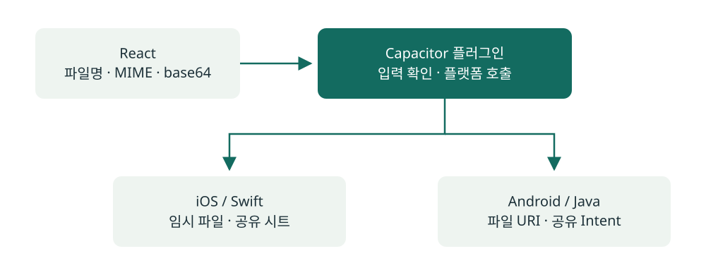

# React에서 만든 파일을 iOS·Android로 공유하기

H2CARE Biz · React, TypeScript, Capacitor, Swift, Java

[H2CARE Biz 앱 화면과 구동 방식](../apps/h2care-biz.md)

공유 입력과 iOS 공유 시트를 새로 구현한 공개 예제: [SharePayload](../examples/swift/Sources/CaseStudyCore/SharePayload.swift), [SystemFileShare](../examples/swift/Sources/UIKitExamples/SystemFileShare.swift). 이번 예제는 iOS 부분이며 [재구현 범위](../examples/README.md)에 설명돼 있습니다.

## 맡은 범위

React 웹과 Capacitor 기반 iOS·Android 앱 전반을 개발했습니다.
업무 화면과 API 연동 외에도 카메라·위치·푸시 권한, Android 뒤로 가기와 웹·앱 화면 이동을 다뤘습니다.

그중 파일 공유는 웹에서 만든 데이터를 각 플랫폼의 공유 기능으로 연결한 작업입니다.

## 구현 흐름

React에서 파일명, MIME 타입과 base64 데이터를 넘기면 Capacitor 플러그인이 입력을 확인하고 플랫폼 기능을 호출하도록 구성했습니다.

### iOS

- Swift 플러그인에서 데이터를 파일로 만들었습니다.
- `UIActivityViewController`로 공유 시트를 열었습니다.
- iPad에서는 popover 위치를 지정했습니다.
- 입력 확인과 파일 생성·공유 준비 중 오류를 웹 호출 쪽으로 전달했습니다.

### Android

- Java 플러그인에서 파일을 만들고 `FileProvider`로 URI를 제공했습니다.
- `ACTION_SEND`와 파일 MIME 타입을 설정했습니다.
- 공유 대상이 파일을 읽을 수 있도록 URI 읽기 권한을 전달했습니다.
- 잘못된 입력이나 파일 준비 실패를 웹 호출 쪽으로 전달했습니다.

## 플랫폼 차이를 처리한 부분

공통 입력은 웹에서 전달하고, 실제 파일 경로와 공유 UI·권한은 각 플랫폼에서 처리했습니다.
같은 공유 동작이라도 iPad의 화면 표시 방식과 Android의 URI 접근 방식이 달라 네이티브 구현이 필요했습니다.

앱 구성에서는 CocoaPods에서 Swift Package Manager로의 전환과 Vite 빌드·네이티브 프로젝트 동기화도 관리했습니다.

## 기기에서 확인할 항목

파일명·데이터가 잘못된 경우, 공유 가능한 앱이 없는 경우, iPad 표시, 공유 후 앱 복귀를 나눠 확인할 수 있습니다.

[전체 포트폴리오로 돌아가기](../README.md)
