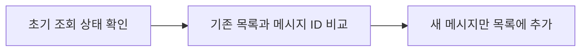
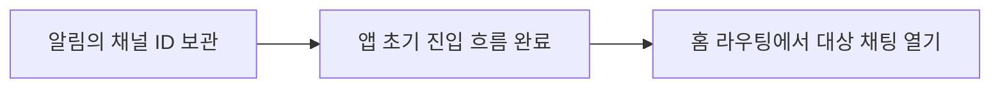

# 채팅 중복 수신과 앱 시작 중 알림 진입

카찹 iOS · Swift, UIKit, 채팅 SDK, 푸시

## 초기 조회와 실시간 수신이 겹치는 경우

메시지 목록을 처음 조회하는 동안 SDK의 실시간 수신 이벤트가 함께 들어올 수 있었습니다.
같은 메시지가 두 경로로 들어오면 목록에 다시 추가되지 않도록 처리해야 했습니다.

초기 로딩 완료 여부를 확인하고, 기존 목록과 수신 메시지의 ID를 비교하도록 수정했습니다.

이벤트를 받을 때마다 바로 추가하는 대신, 현재 목록의 상태와 메시지 식별자를 기준으로 반영 여부를 결정했습니다.

## 앱이 시작되는 동안 채팅 알림을 누르는 경우

앱 시작 중에는 채팅 화면을 바로 열기 어려운 단계가 있었습니다.
초기 화면에서 이동할 채널 ID를 보관하고, 홈의 서비스 라우팅에서 채팅으로 이동하도록 연결했습니다.

화면 이동에 필요한 값을 다음 진입 단계로 넘겨, 앱이 준비되는 순서에 맞춰 사용하도록 바꾼 작업입니다.
관련 PR에서는 푸시 진입에 따른 화면 닫기 분기를 보완하라는 동료 리뷰도 받았습니다.

## 다시 개발한다면

조회 성공뿐 아니라 실패·지연과 앱 종료 상태의 알림 진입을 나눠 검증하겠습니다.
비동기 대기가 성공과 실패 경로에서 모두 해제되는지, 화면이 이미 열려 있을 때 어떻게 처리하는지도 함께 확인하겠습니다.

[전체 포트폴리오로 돌아가기](../README.md)
