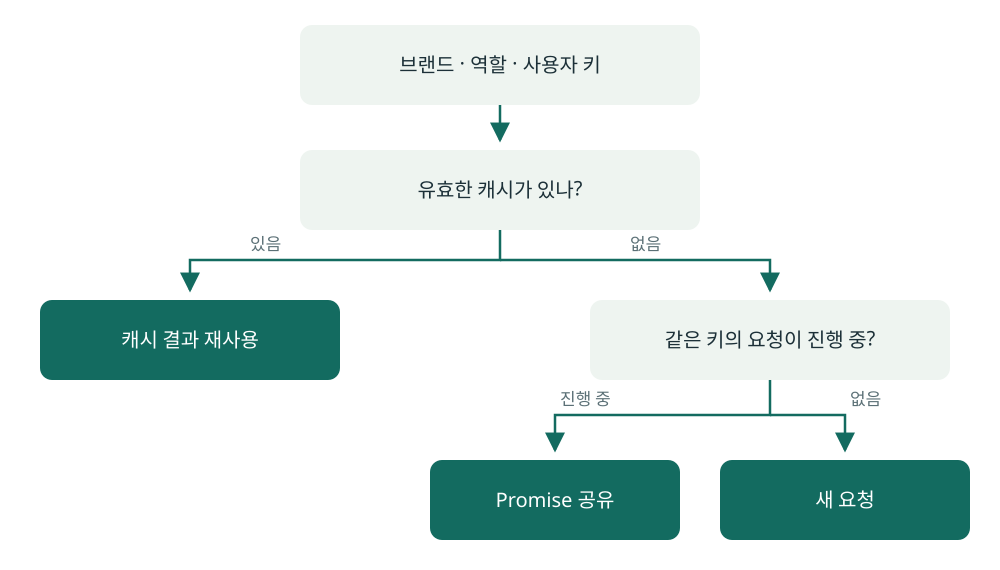

# 여러 화면에서 사용하는 데이터 요청 관리

H2CARE BizPro·관리자 웹 · React, TypeScript, React Query

관련 문제를 새로 구현한 공개 예제: [RequestPool](../examples/react/src/RequestPool.ts), [React 훅](../examples/react/src/useSharedResource.ts), [테스트 안내](../examples/react/README.md). [제품 변경과 예제의 범위](../examples/README.md)를 함께 볼 수 있습니다.

## 상황

여러 화면에서 같은 충전소 데이터를 조회하고, 사용자나 역할에 따라 다른 결과를 보여줘야 했습니다.
이미 받은 데이터와 아직 진행 중인 요청을 구분하고, 강제 갱신 시 기존 요청도 정리할 필요가 있었습니다.

## 캐시와 진행 중 요청을 구분

브랜드·역할·사용자를 기준으로 조회 키를 나눴습니다.

| 상태 | 처리 |
| --- | --- |
| 유효한 캐시가 있음 | 같은 키의 결과 재사용 |
| 같은 키의 요청이 진행 중 | 진행 중인 Promise를 공유해서 결과를 기다림 |
| 강제 갱신 | 기존 요청을 취소하고 새 요청으로 교체 |
| 요청 완료 | 결과를 캐시하고 화면 상태에 반영 |

강제 갱신은 이 조회 흐름과 구분해 기존 요청을 취소·교체했습니다.
요청을 보내는 일과 요청 상태를 관리하는 일을 함께 정리한 작업입니다.

## 화면과 서버 상태를 맞춘 작업

- Biz 앱의 충전소 홈 데이터를 React Query 훅으로 옮겼습니다.
- 운영상태를 변경한 뒤 관련 데이터를 무효화하도록 연결했습니다.
- 관리자 웹의 충전소 상세를 선택한 충전소 ID의 실제 API 값으로 연결하고 로딩·실패·빈 응답을 표시했습니다.
- 화면 전환 중 취소된 이전 조회가 현재 화면의 상태를 덮지 않도록 처리했습니다.

## 이 작업에서 신경 쓴 점

캐시는 언제 재사용할지, 진행 중 요청은 누가 기다릴지, 갱신은 무엇을 취소할지를 구분했습니다.
화면에 데이터가 보이는 것과 그 데이터가 현재 선택·권한·서버 상태에 맞는지도 함께 확인했습니다.

[전체 포트폴리오로 돌아가기](../README.md)
